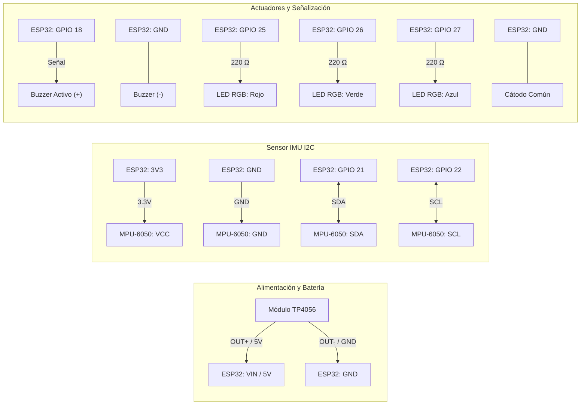

# Equipo-4-Embebidos

# Detector Personal de Caídas 

**Instituto Politécnico Nacional**  
**Escuela Superior de Cómputo (ESCOM)**  
**Ingeniería en Inteligencia Artificial**  
*Materia:* Aplicaciones de IA en Sistemas Embebidos (Grupo 7BM1)  
*Profesor:* Rodrigo Ojeda Santillán  

---

##  Integrantes — Equipo 4

* **Izquierda Garnica Lizett** — Boleta: `2024630308`
* **Salceda Solórzano Norma Angélica** — Boleta: `2024630566`
* **Sánchez Cornejo Gael Antonio** — Boleta: `2023630660`

---

##  Descripción del Proyecto

El proyecto consiste en el diseño e implementación de un dispositivo físico embebido tipo *wearable* capaz de monitorear la orientación y aceleración corporal en tiempo real, ejecutando un modelo de aprendizaje automático directamente en el microcontrolador (inferencia en el borde / TinyML) para detectar caídas accidentales.

### Problemática que resuelve
Las caídas no detectadas en personas de la tercera edad y las afecciones asociadas a una mala postura representan un grave riesgo para la salud física y la calidad de vida. La ausencia de sistemas locales de monitoreo continuo en tiempo real retrasa la intervención médica oportuna, provocando lesiones severas, secuelas crónicas o complicaciones críticas. Este sistema alerta de forma local e inmediata ante impactos o pérdidas de verticalidad abruptas, facilitando la pronta asistencia.

### Usuarios objetivo
* Adultos mayores que viven solos y requieren auxilio rápido ante accidentes.
* Personas con movilidad reducida o antecedentes de desvanecimientos.
* Pacientes en programas de rehabilitación motriz y corrección postural.
* Trabajadores en áreas operativas y tareas de alto riesgo.

---

##  Arquitectura de Hardware y Presupuesto

El diseño se basa en componentes de bajo costo verificados eléctricamente antes de su energización:

| Componente | Función Principal | Costo Estimado (MXN) |
| :--- | :--- | :--- |
| **ESP32** (NodeMCU-32S / DevKit) | Microcontrolador principal; procesamiento continuo del flujo de datos e inferencia del modelo en el borde | \$160.00 |
| **MPU-6050** (IMU de 6 DoF) | Sensor inercial; mide aceleración tridimensional (\\(a_x, a_y, a_z\\)) y velocidad angular (\\(\omega_x, \omega_y, \omega_z\\)) | \$70.00 |
| **Buzzer Activo de 5V** | Actuador acústico para emisión de alarma sonora local inmediata tras impacto | \$20.00 |
| **LED RGB** | Señalización óptica del estado del sistema (normal, advertencia postural, alarma de caída) | \$5.00 |
| **Módulo TP4056** | Gestión y protección de carga para batería Li-Po/Li-Ion de alimentación portátil | ~\$25.00 |
| **Total Estimado** | | **\$280.00 MXN** |

